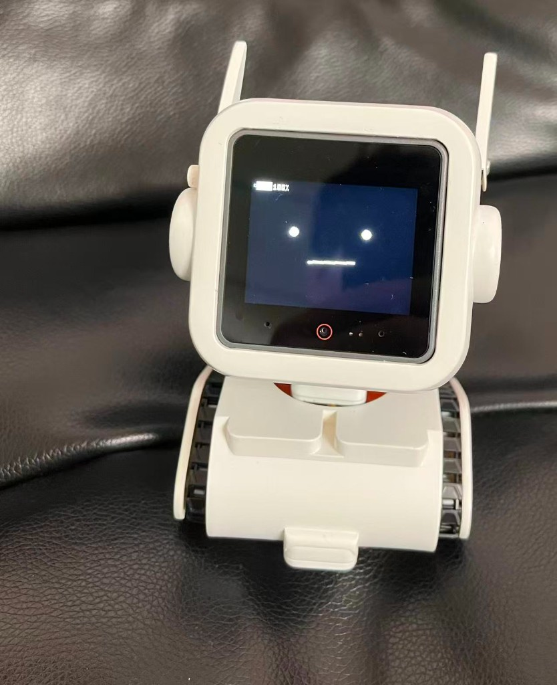

# Palbei for Stack-chan

**Palbei for Stack-chan**（仓库名 `palbei-stackchan`）是面向创客的 MIT 开源固件，运行在 [M5Stack](https://m5stack.com/) CoreS3 上：会用轮子走路的桌面小伴，支持地面走动与跟随，兼容社区常见的舵机 / 轮子 / 传感器接线。

本项目基于开源项目 [Stack-chan](https://github.com/stack-chan/stack-chan) 演进；上游项目版权与贡献者归原作者所有，感谢 Stack-chan 社区。

## 关于我们

**Palbei（北北小伴）** 专注桌面陪伴机器人。产品「北北」是一台会感知、会跟随、会聊天、会表演的桌面伙伴：雷达与视觉感知环境，可在桌面安全互动，也能下地活动。

<p align="center">
  
</p>

我们把这套开源固件贡献给创客社区，方便大家基于 CoreS3 与常见外设，打造、改造属于自己的桌面机器人。完整官方系统与产品介绍见官网：[www.palbei.com](https://www.palbei.com)。

感谢 M5Stack 提供优秀的 CoreS3 主控硬件与软件生态。

> 本开源版**不经过任何商业官方云中转**。设备把录音直接发到你自己配置的 STT 服务，由该服务完成识别、对话、语音合成后再把 WAV 回给设备播放。

## License

- Project source: [MIT](LICENSE)
- Third-party notices: [NOTICE](NOTICE)
- Upstream: [stack-chan/stack-chan](https://github.com/stack-chan/stack-chan)

## 硬件与环境

- 主板：M5Stack CoreS3（16MB Flash，分区表 `my_cores3_16MB.csv`）
- 构建工具：[PlatformIO](https://platformio.org/)（推荐配合 VS Code 使用）
- 唤醒聊天依赖板载 / 外挂的**离线语音识别模块**（固件里用串口协议识别「北北」等词）；纯 CoreS3 无该模块时无法用唤醒词进聊天
- 聊天对话依赖你自建的 **STT 一体服务**（见下文协议）

### 安装构建工具（PlatformIO）

推荐方式：**VS Code + PlatformIO IDE 扩展**（图形界面，新手更省事）。

1. 安装 [VS Code](https://code.visualstudio.com/)
2. 打开扩展市场，搜索 **PlatformIO IDE**，安装官方扩展（发布者 `platformio.platformio-ide`）
3. 安装完成后按提示重载窗口；首次启动会自动准备 PlatformIO Core，需等待几分钟并保持网络畅通
4. 用菜单 **File → Open Folder…** 打开本仓库根目录（含 `platformio.ini` 的那一层）
5. 用 USB 线连接 CoreS3，在 PlatformIO 工具栏选择环境 `palbei`，即可编译 / 烧录

也可只装命令行 **PlatformIO Core**（适合已熟悉终端的用户）：

1. 先安装 [Python 3](https://www.python.org/downloads/)（安装时勾选 Add to PATH）
2. 打开终端执行：

```bash
pip install -U platformio
pio --version
```

3. 若提示找不到 `pio`，把 Python 的 `Scripts` 目录加入 PATH，或使用：

```bash
python -m platformio --version
```

Windows 若烧录时识别不到端口，可安装 [CP210x](https://www.silabs.com/developers/usb-to-uart-bridge-vcp-drivers) / [CH340](http://www.wch.cn/downloads/CH341SER_EXE.html) 等对应 USB 串口驱动，并在设备管理器中确认端口号。

更完整的官方说明见：[PlatformIO 文档](https://docs.platformio.org/en/latest/core/installation.html)。

## 编译与烧录

可以把它理解成两步：**先告诉固件「对话服务在哪」→ 再把程序装进 CoreS3**。

### 1. 先填对话服务地址（必做）

打开 `src/CloudConfig.h`，把下面三项改成你自己的 STT 服务（不要用示例占位符）：

- `STT_API_SCHEME`：一般是 `https`（家里局域网调试可用 `http`）
- `STT_API_HOST`：服务器域名或 IP（可带端口，如 `192.168.1.10:3001`）
- `STT_API_PATH`：接口路径（如 `/stt`）

没改对的话，设备能开机、能动，但**说「北北」后对话会失败**（请求发到无效地址）。

### 2. 把程序装进设备

用 USB 线连接 CoreS3，然后任选一种方式：

**方式 A（推荐，图形界面）**  
在 VS Code 的 PlatformIO 工具栏点：

1. **Build**（编译）— 把源码编成固件  
2. **Upload**（上传）— 烧录到已连接的 CoreS3  

**方式 B（命令行）**  
在仓库根目录（有 `platformio.ini` 的那一层）打开终端：

```bash
# 只编译，检查能否通过
pio run -e palbei

# 编译并烧录到设备（需已用 USB 连上）
pio run -e palbei -t upload
```

说明：

- `-e palbei` 是本仓库的 PlatformIO 环境名（对应 CoreS3 硬件配置）  
- 第一次编译会下载平台和依赖库，可能要等几分钟，属正常  
- 烧录前请确认电脑能识别串口（Windows 可能要装 CP210x / CH340 驱动）

## 配置自己的 STT 服务

编辑 `src/CloudConfig.h`：

```c
#define STT_API_SCHEME "https"           // 也可 "http"（仅建议局域网调试）
#define STT_API_HOST   "api.example.com" // 可带端口，如 192.168.1.10:3001
#define STT_API_PATH   "/stt"
```

也可用编译宏覆盖，例如：

```ini
build_flags =
  -DSTT_API_SCHEME=\"http\"
  -DSTT_API_HOST=\"192.168.1.10:3001\"
  -DSTT_API_PATH=\"/rebotstt\"
```

**请勿把真实密钥、证书、私人域名提交进公开仓库。**

### 设备 ↔ 服务协议（录音进，WAV 出）

1. 设备录音得到 WAV
2. `POST {SCHEME}://{HOST}{PATH}`，`multipart/form-data`：
   - 字段 `audio`：音频文件（`audio.wav`）
   - 字段 `device_id`：设备唯一 ID
3. 服务端自行完成 **STT → LLM → TTS**
4. 响应二选一：
   - **较大响应（约 >10KB）**：完整 **WAV**，设备边收边播
   - **较小响应**：JSON 动作（如舵机 `motion`、表情 `expression`、关机 `shutdown` 等）

## 配网（Wi‑Fi）

首次上电或已保存的 Wi‑Fi 连不上时，会进入配网模式：

1. 屏幕显示「配置 WiFi」，并给出热点名称，形如：  
   `Palbei-xxxxxxxx`
2. 用手机 / 电脑连接该热点
3. 浏览器打开 **`http://192.168.4.1`**（ESP32 SoftAP 网关）
4. 在页面里选择家里的 Wi‑Fi、输入密码，点「立即连接」
5. 配置写入后设备会重启并自动连网

说明：

- 配网页大约 **60 秒**内有效；超时会退出配网模式并继续启动（可能仍无网）
- 配网成功后设备会自动重启
- 换路由器或改密码后，让设备连不上旧 Wi‑Fi，即可再次进入配网

## 日常使用

### 启动聊天

1. 确认设备已连上 Wi‑Fi，且你的 STT 服务可达
2. 对着机器人说离线唤醒词 **「北北」**
3. 设备点头示意后进入聆听，屏幕提示「聆听中…」
4. 说话 → 上传 → 思考 → 播放回复；播完后会自动进入下一轮聆听（多轮聊天）

更换其它唤醒词时：

1. 按 [启英泰伦官方文档](https://document.chipintelli.com/) 改离线 ASR 模块词库
2. 同步修改固件里该词对应的**命令编号映射**（串口协议 `case`），否则设备听得到词也不会进聊天

### 退出聊天

在屏幕显示 **「聆听中…」**（等待你开口）时，**点一下屏幕**即可退出本轮多轮聊天。  
设备会提示「下次再聊」，并停止自动进入下一轮录音。

注意：已经开口开始录音、或正在「思考中 / 播放回复」时，点屏不会当作退出；请等到下一轮「聆听中…」再点。

### 自由走动（长按屏幕）

在屏幕上 **长按**（约 0.3 秒以上）可开关「自由走动」：

- 开启：提示「自由走动」，允许轮子 / 寻人等相关行为
- 关闭：提示「停止走动」，并停下轮子

这与「退出聊天」是两套操作：退出聊天用**短按**，开关走动用**长按**。

## 使用流程小结

```
烧录（先配 CloudConfig）
    → 上电配网（连 AP → 打开 192.168.4.1）
    → 说「北北」进入聊天
    → 多轮对话（播完自动再听）
    → 「聆听中…」时点一下屏幕退出
```

## Notes

- 无网或 STT 地址错误时，本地表情 / 舵机等仍可用，但无法完成对话
- 局域网调试可用 `http`；公网建议 `https`

